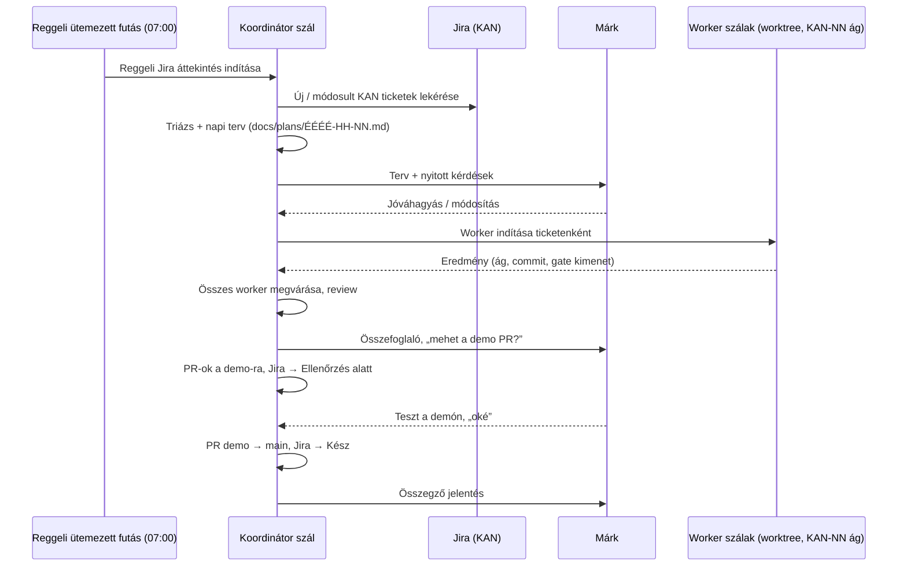

# ReformStudioSync — Fejlesztési Munkafolyamat (Koordinátor + Worker szálak)

Ez a dokumentum rögzíti, hogyan érkeznek be, hogyan tervezzük, valósítjuk meg és dokumentáljuk a változásokat. Minden AI agent (Claude Code, Cursor, Codex) és fejlesztő számára kötelező.

Egy-egy Jira ticket végigvitelének lépéseit (ticket → terv → `KAN-NN` ág → gate → PR a `demo`-ra → teszt → PR a `main`-re) a **`reform-ticket` skill** írja le: [`.claude/skills/reform-ticket/SKILL.md`](../.claude/skills/reform-ticket/SKILL.md). Ez a dokumentum az e fölötti koordinációt rögzíti.

---

## 1. Szerepek

| Szerep | Ki / mi | Feladat |
| --- | --- | --- |
| **Megrendelő** | Márk | Csak a **Koordinátor szállal** kommunikál: jóváhagyja a tervet, tesztel a demón, „mehet”-et ad a PR-okra. |
| **Koordinátor szál** | Egyetlen, hosszan élő agent szál | Jira ticketek átnézése, terv készítése, worker szálak indítása, megvárása, eredményeik ellenőrzése, PR-ok és Újdonságok bejegyzések, jelentés a Megrendelőnek. |
| **Worker szál** | A Koordinátor által indított agent, saját git worktree-ben | Egy KAN ticket megvalósítása a `reform-ticket` skill 3–5. fázisa szerint (ág, implementáció, gate, review, commit), visszajelentés a Koordinátornak. |

**Alapszabályok**

- A Megrendelő **soha nem** kommunikál közvetlenül worker szállal; minden kérdés és eredmény a Koordinátoron keresztül megy.
- Worker szál nem indít további szálakat, és nem kérdez a Megrendelőtől — elakadásnál a Koordinátornak jelez.
- A Koordinátor **megvárja az összes általa indított worker szálat**, mielőtt összegző jelentést ad. Félkész állapotot nem jelent késznek.
- Ticketenként egy worker, egy worktree, egy `KAN-NN` ág és egy `demo` PR. A független ticketek párhuzamosan futnak; ha két ticket ugyanazokat a fájlokat érinti, sorban, és az megy előbb a `demo`-ra, amelyikre a másik épül.
- A két megállási pont a Megrendelőé: **a terv után** és **a demós teszt után**. A `demo` és a `main` PR-hoz külön „mehet” kell.

---

## 2. Napi ciklus

### 2.1. Reggeli Jira áttekintés (ütemezett)

- **Időpont:** minden munkanap 07:00 (Europe/Budapest).
- **Futtatója:** a Koordinátor szál (ütemezett feladatként, pl. T3 Code `schedule_task` / Claude Code `/schedule`).
- **Előfeltétel:** Jira hozzáférés az agent számára (`JIRA_EMAIL` + `JIRA_API_TOKEN` / `JIRA_API_TOKEN_FILE`, lásd `.claude/skills/reform-ticket/references/jira.md`). A változók Windows felhasználói szinten vannak beállítva; ha egy agent munkamenet ezek felvétele előtt indult, onnan kell betöltenie. *Állapot: aktív — T3 ütemezett feladat, hétfőtől péntekig 07:00, a Koordinátor szálba jelent.*
- **Lekérdezés:** `python .claude/skills/reform-ticket/scripts/reform_ticket.py list --jql 'project=KAN AND statusCategory != Done AND updated >= -1d ORDER BY priority DESC'`
- **Kimenet:** napi terv a `docs/plans/` mappában (lásd 2.2), és rövid üzenet a Koordinátor szálban.

Az ütemezett futás promptja:

> Reggeli Jira áttekintés: a `reform-ticket` skill scriptjével kérd le az elmúlt nap új és módosult, nem lezárt KAN ticketjeit. Mindegyikhez: rövid összefoglaló, típus (NEW_FEATURE / NEW_PAGE / IMPROVEMENT / FIX), érintett FSD rétegek és modulok, becsült méret, függőségek, nyitott kérdések. Készítsd el a `docs/plans/ÉÉÉÉ-HH-NN.md` tervet a `docs/plans/README.md` sablonja szerint, és küldd el jóváhagyásra. Worker szálat jóváhagyás előtt ne indíts, a Jirába ne írj.

### 2.2. Terv

Minden munkához (a reggeli áttekintésből vagy eseti kérésből) a Koordinátor tervet készít a `docs/plans/` mappába — sablon: [`docs/plans/README.md`](plans/README.md). A terv tartalmazza a ticketeket, a worker-bontást (mi fut párhuzamosan, mi sorban), az elfogadási feltételeket, a tervezett Újdonságok bejegyzéseket és a nyitott kérdéseket. **Megvalósítás csak jóváhagyott terv alapján indul.**

### 2.3. Worker szálak

A Koordinátor minden workernek önálló, teljes briefet ad:

- KAN kulcs, a ticket szövege és a terv vonatkozó része.
- Utasítás: a `reform-ticket` skill 3–5. fázisa szerint dolgozzon (`KAN-NN` ág, implementáció, `gate.sh`, `simplify` + `code-review`, commit). PR-t a worker nem nyit, Jirába nem ír.
- Érintett FSD rétegek/fájlok, kötelező projektszabályok (lásd 4. pont).
- Ha a ticket felhasználó számára látható változás: Újdonságok bejegyzés ugyanabban a commitban (lásd 3. pont).
- Visszajelentés formája: ág, commit SHA, gate kimenete, kézi ellenőrzés, nyitott kérdések.

### 2.4. Lezárás

1. Koordinátor ellenőrzi a worker eredményeket (review, gate újrafuttatása).
2. „Mehet” után PR-ok a `demo`-ra, Jira → *Ellenőrzés alatt*, tesztlista a Megrendelőnek.
3. „Oké” után PR `demo` → `main`, merge után Jira → *Kész*.
4. Ha kiadás készül: `docs/versions/<verzió>v.md`, `docs/DEVELOPMENT_LOG.md`, és a verziószám a `widgets/version-changelog`-ban.
5. Összegző jelentés a Megrendelőnek: mi készült el, mi maradt nyitva, melyik ticket milyen állapotban van.

---

## 3. Újdonságok bejegyzés (`apps/web/src/pages/reception/model/releaseNotes.ts`)

A Recepció **„Újdonságok”** menüpontja (`pages/reception/ui/WhatsNewPanel.tsx`) a `RELEASE_NOTES` tömbből épül. Minden felhasználó számára érzékelhető változáshoz kell bejegyzés.

| Mező | Szabály |
| --- | --- |
| `id` | Stabil, egyedi (pl. `v0.3-guest-export`). Utólag nem módosítható — erre épül az olvasottság jelölése. |
| `kind` | `NEW_PAGE` (új oldal), `NEW_FEATURE` (új funkció), `IMPROVEMENT` (fejlesztés), `FIX` (javítás). |
| `jiraKey` | **Kötelező** KAN kulcs (pl. `KAN-12`) a visszakövethetőséghez. `null` csak a Jira előtti (≤ v0.2) tételeknél megengedett. |
| `link` | **Csak** `NEW_PAGE` / `NEW_FEATURE` esetén, és **csak ha az újdonság a felületen ténylegesen megtekinthető**. Recepciós fülre: `{ type: 'receptionTab', tab }`, külön oldalra: `{ type: 'route', path }`. `IMPROVEMENT` / `FIX` esetén csak leírás van — a típus ezt kikényszeríti. |
| `summary`, `details` | Recepciós nyelven, nem műszaki szakszavakkal. |

- A legújabb bejegyzés a tömb elejére kerül.
- A jegyazonosító a Jira ticketre linkel (`https://reformstudiosync.atlassian.net/browse/KAN-NN`; felülírható: `VITE_JIRA_BASE_URL`).
- A még nem látott bejegyzések számát piros jelvény mutatja a menüpontban; megnyitáskor „Új” címkét kapnak.

---

## 4. Kötelező projektszabályok (minden szál számára)

- **FSD rétegek:** importálni csak alsóbb rétegből, slice-ot csak a publikus `index.ts`-én keresztül (`docs/ARCHITECTURE.md` 1.2, `npm run lint:fsd`).
- **Sötét/Világos téma:** minden új UI elem támogatja mindkét témát (`.cursor/rules/theme-support.mdc`). Kivétel: a Vendégmonitor fix dizájnja.
- **Nyelv:** felhasználói felület és dokumentáció magyarul.
- **Mock pár:** minden új vagy módosított API-végponthoz `shared/api/mock-engine.ts` pár.
- **Tranzakciók:** bérlet-/pénzügyi módosítás csak atomi Prisma `$transaction`-ben.
- **Gate jelentés előtt:** `bash .claude/skills/reform-ticket/scripts/gate.sh`. Sikertelen ellenőrzést kimenettel együtt kell jelenteni.
- **Dokumentáció:** architektúra-változás → `docs/ARCHITECTURE.md`; kiadás → `docs/versions/`; minden felhasználói változás → Újdonságok bejegyzés.
