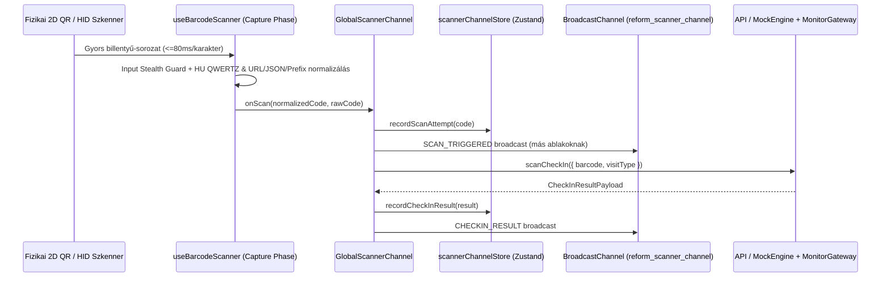
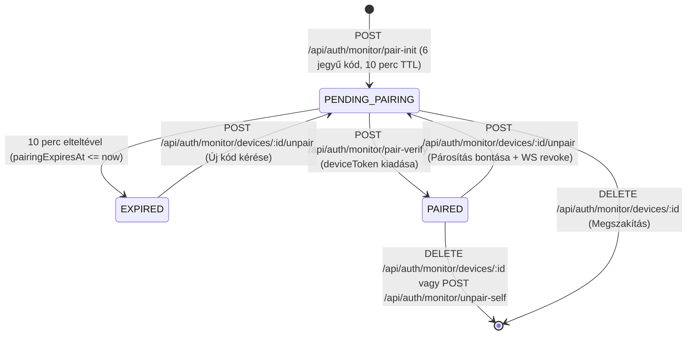

# ReformStudioSync — v0.2 Technikai Dokumentáció (Új Funkciók és Opciók)

Ez a dokumentum a **ReformStudioSync v0.2** kiadásában bekerült új modulok, architektúra-bővítések, API végpontok, WebSocket/Broadcast események és recepciós/adminisztrátori funkciók teljes körű műszaki leírását tartalmazza.

---

## 1. Beolvasztott Ágak és Kiadási Összefoglaló

A `v0.2` kiadás három fő fejlesztési ág funkcióit egyesíti a `main` ágon:
1. **`qrcode-scanning-monitoring` (`85f4164`):** Globális, oldalaktól és fókuszállapottól független 2D QR-kód és 1D vonalkód HID szkenner csatorna, magyar (HU QWERTZ) billentyűzet-normalizációval, Input Stealth Guard védelemmel és ablakok közötti (`BroadcastChannel`) szinkronizációval.
2. **`monitor-pairing` (`24124fe`):** Fejlett Dual-Mode Vendégmonitor jogosultsági és eszközpárosító rendszer 10 perces lejáratú (TTL) 6 jegyű párosító kódokkal, egyedi kijelzőnév-kényszerítéssel, valós idejű életciklus-kezeléssel (teszt jel, átnevezés, újragenerálás, távoli és helyi leválasztás) és aktivitás-naplózással.
3. **`missing-features` (`4471163`):** Kettős érkezési modell (Köredzés vs. Alkalmas kezelés), adatvédett Vendégmonitor megjelenítés, havi tagságok és hátralékkezelés (`OverdueBucket`), részbefizetés és pénzügyi allokáció, bővített vendégkartoték (testmérések, WebP képoptimalizáló, belső megjegyzések, e-mail napló) és önálló dokumentum-aláíró tablet felület (`/tablet`).

---

## 2. Globális 2D QR-kód és Vonalkód Szkennelési Csatorna

A rendszer alkalmazásszintű fizikai (USB / Bluetooth HID) 2D QR-kód és vonalkódolvasó csatornát biztosít, amely bármely megnyitott nézeten (`/reception`, `/monitor`, `/tablet`, `/demo` — a `/login` kivételével) érzékeli és feldolgozza a kártyaleolvasásokat.

### 2.1. Fizikai HID Szkenner Hook (`apps/web/src/hooks/useBarcodeScanner.ts`)

- **Capture-fázisú globális eseményfigyelés (`window.addEventListener('keydown', ..., { capture: true })`):**
  - Karakterenkénti időkülönbség mérése (`maxIntervalMs = 80` ms, `minLength = 4`).
  - Lezáró karakterek támogatása: `Enter` és `Tab` (2D QR olvasóknál gyakori CR/LF vagy Tab lezárás).
  - **Auto-Commit időzítő (`autoCommitTimeoutMs = 110` ms):** Ha a 2D QR-olvasó nem küld lezáró `Enter`/`Tab` billentyűt, a rendszer legalább 6 karakteres gyors gépi sorozat (`avg <= maxIntervalMs * 0.85`) után automatikusan véglegesíti a leolvasást.
  - A módosító billentyűket (`Shift`, `CapsLock`, `AltGraph`, `Control`, `Alt`) figyelmen kívül hagyja, hogy ne törjék meg a gépi karakterfolyamot.

- **Input Stealth Guard (Fókuszált űrlapmezők védelme):**
  - Ha a recepciós kurzora egy keresőmezőben vagy szöveges inputban áll (kivéve a `data-barcode-input="true"` attribútumú dedikált manuális vonalkód mezőt), a hook `inputSnapshotRef`-ben rögzíti a mező leolvasás előtti értékét (`valueBeforeBurst`).
  - Amint a 2. gyors gépi karakter beérkezik (`bufferRef.current.length >= 2`), a hook `e.preventDefault()` és `e.stopPropagation()` hívással megállítja a karakterek beírását, és a `HTMLInputElement.prototype.value` natív setterével visszaállítja a mező eredeti tartalmát (`restoreFocusedInputIfPolluted()`).

- **Magyar (HU QWERTZ) billentyűzet és összetett QR-payload normalizáció (`normalizeScannedCode`):**
  - **Fizikai billentyűkód feloldás (`resolveScannerChar`):** A `KeyboardEvent.code` (`Digit0`–`Digit9`, `Numpad0`–`Numpad9`) alapján nyelvi kiosztástól függetlenül kinyeri a számjegyet.
  - **HU Shift/CapsLock karaktertérkép (`HU_SHIFTED_DIGIT_MAP`):** A magyar billentyűzeten eltolt szimbólumokat (`§'"+!%/=()` -> `0123456789`, valamint `ÖÜÓ` -> `0-#`) automatikusan visszaalakítja.
  - **Strukturált QR-kódok tisztítása:**
    - JSON payload kicsomagolás (`{"barcode":"100001"}`, `code`, `card`, `guestBarcode`, `id` kulcsok).
    - URL alapú QR-kódok feloldása (`https://.../checkin/100001` vagy `?barcode=100001`).
    - Előtagok eltávolítása (`REFORM:100001`, `STUDIO:100001`, `PASS-100001`, `CARD:100001`, `QR:100001`, `BARCODE=100001`, `#100001`).

### 2.2. Szkenner Állapotkezelés (`apps/web/src/stores/scannerChannelStore.ts`)

A `useScannerChannelStore` Zustand store az alábbi állapotokat és akciókat kezeli:
- `isListening: boolean` — A globális QR/vonalkód figyelés engedélyezése vagy szüneteltetése (a Recepciós Pult és a Demo fejlécéből 1 kattintással kapcsolható).
- `isProcessing: boolean` — Folyamatban lévő API beléptetési kérés jelzése.
- `scanCount: number` — Munkamenet során érzékelt leolvasások számlálója.
- `lastScannedCode: string | null` és `lastScanAt: string | null` — Az utoljára beolvasott kód és időbélyege.
- `lastCheckInResult: CheckInResultPayload | null` és `lastRevokedResult: CheckInRevokedPayload | null`.
- `scanHistory: CheckInResultPayload[]` — Az utolsó 12 leolvasás memóriabeli előzménylistája.

### 2.3. Globális Szkenner Komponens (`apps/web/src/components/GlobalScannerChannel.tsx`)

- Az `App.tsx` gyökerében futó vezérlő komponens (`!isLoginPage` esetén aktív).
- **Offline hibatűrés:** Ha `!isOnline`, a beolvasott kódot automatikusan az `offlineQueueStore`-ba helyezi (`enqueueScan(code)`).
- **Ablakok közötti szinkronizáció (`SCANNER_BROADCAST_CHANNEL = 'reform_scanner_channel'`):**
  - Ha a fizikai olvasó akkor csippant, amikor a `/monitor` vagy a `/tablet` ablak van előtérben, a `GlobalScannerChannel` végrehajtja a beléptetést, majd a `BroadcastChannel` és a WebSocket csatornán keresztül azonnal frissíti a `/reception` ablakban lévő „Utolsó Beléptetés Állapota” kártyát és a React Query cache-t (`guests`, `today-checkins`, `today-dashboard`, `overdue-memberships`).
- **Adatvédelmi védelem a `/monitor` oldalon:** Ha a leolvasás a `/monitor` útvonalon történik (`isMonitorPage === true`), a komponens nem jelenít meg recepciós Toast értesítést (amely tartozást vagy bérletszámot tartalmazna), hanem kizárólag a `MonitorDisplayCard` adatvédett nézetét aktiválja.

---

## 3. Fejlett Dual-Mode Vendégmonitor Párosítás és Eszközmenedzsment

A Vendégmonitor (`/monitor`) két szigorúan elkülönített üzemmódot támogat, 10 perces lejáratú 6 jegyű párosító kódokkal, egyedi eszköznév-ellenőrzéssel és teljes távoli/helyi felügyelettel.

### 3.1. Dual-Mode Jogosultsági Modell (`apps/web/src/features/monitor/MonitorPage.tsx`)

- **1. Üzemmód — Azonos PC Másodlagos Kijelző (`isStaffAuthenticated`):**
  - Ha a böngészőben a recepciós vagy admin be van jelentkezve (`accessToken` jelen van az `authStore`-ban), a `/monitor` oldal **6 jegyű párosító kód bekérése nélkül azonnal működik**.
  - A fejlécben megjelenik a `Recepciós PC Másodlagos Kijelző ([Munkatárs Neve])` jelzés és a közvetlen visszaút (`/reception`).
- **2. Üzemmód — Önálló Tablet / iPad / Smart TV (`isDevicePaired`):**
  - Ha az eszközön nincs bejelentkezett munkatárs (`!accessToken`) és nincs párosított `deviceToken`, a `/monitor` oldal **kötelező zárolási képernyőt** jelenít meg, ahol kizárólag a 6 jegyű párosító kód adható meg.
  - Párosítás után az eszköz elmenti a `deviceToken`, `deviceName` és `deviceId` értékeket az `authStore`-ba (`reform-studio-auth` localStorage kulcs).
  - A fejlécben elérhető a **„Párosítás megszakítása”** (`handleUnpairDevice`) gomb kétlépcsős megerősítéssel (`Leválasztod? -> Igen, bontás / Mégse`).
  - Az URL-ből minden query paraméter automatikusan törlődik (`window.history.replaceState({}, '', '/monitor')`), így párosító kód soha nem maradhat a címsorban.

### 3.2. Adatbázis Séma (`apps/api/prisma/schema.prisma` — `DisplayDevice`)

| Mező | Típus | Leírás |
| :--- | :--- | :--- |
| `id` | `String @id @default(uuid())` | Kijelző egyedi azonosítója |
| `studioId` | `String @default("default-studio")` | Stúdió azonosító (`@@unique([studioId, name])` megszorítással) |
| `name` | `String` | Kijelző egyedi neve (pl. `Pult iPad #1`) |
| `pairingCode` | `String? @unique` | 6 jegyű párosító kód (sikeres párosítás után `null`) |
| `pairingExpiresAt` | `DateTime?` | A párosító kód lejárati ideje (`createdAt + 10 perc`) |
| `pairedAt` | `DateTime?` | A sikeres párosítás időbélyege |
| `deviceToken` | `String @unique` | 64 karakteres hexadecimális eszköz-token Socket.io hitelesítéshez |
| `isActive` | `Boolean @default(true)` | Eszköz engedélyezett állapota |
| `lastSeenAt` | `DateTime?` | Utolsó élő aktivitás időpontja (párosítás előtt `null`) |
| `lastActivityType` | `String?` | Utolsó rögzített esemény szöveges megnevezése |
| `createdAt` | `DateTime @default(now())` | Létrehozás időpontja |

### 3.3. Kijelző-Párosítási REST API Végpontok (`apps/api/src/modules/auth/auth.controller.ts`)

| Metódus & Útvonal | Jogosultság | Funkció leírása |
| :--- | :--- | :--- |
| `POST /api/auth/monitor/pair-init` | JWT | Új kijelző létrehozása egyedi névvel, 10 perces lejáratú 6 jegyű `pairingCode` generálása (`PENDING_PAIRING`). |
| `POST /api/auth/monitor/pair-verify` | Publikus | 6 jegyű kód ellenőrzése (lejárat vizsgálattal), `pairingCode` törlése, `pairedAt` rögzítése és `deviceToken` visszaadása (`PAIRED`). |
| `GET /api/auth/monitor/devices` | JWT | Stúdió kijelzőinek listázása számított `status` (`PENDING_PAIRING`, `PAIRED`, `EXPIRED`) és élő Socket `isOnline` állapottal. |
| `POST /api/auth/monitor/devices/:id/unpair` | JWT | Meglévő párosítás bontása és új 6 jegyű kód generálása (10 perc TTL) + `monitor:device-revoked` küldése az érintett kijelzőnek. |
| `PATCH /api/auth/monitor/devices/:id` | JWT | Kijelző átnevezése kis-/nagybetű-független névütközés-ellenőrzéssel (`ensureUniqueDeviceName`). |
| `DELETE /api/auth/monitor/devices/:id` | JWT | Folyamatban lévő párosítás megszakítása vagy párosított eszköz végleges törlése + `monitor:device-revoked` értesítés. |
| `POST /api/auth/monitor/unpair-self` | Publikus (`deviceToken`) | Párosítás megszakítása közvetlenül a kijelzőről/tabletről. |
| `POST /api/auth/monitor/test-signal` | JWT | Teszt jel (`monitor:test-ping`) küldése az összes aktív kijelzőre vagy egy kiválasztott `deviceId`-ra. |

### 3.4. WebSocket (`/monitor`) és BroadcastChannel Események

- **`SOCKET_EVENTS.MONITOR_TEST_PING` (`monitor:test-ping`) / `TEST_PING`:**
  - Payload (`MonitorTestPingPayload`): `{ deviceId?: string | null, deviceName?: string | null, senderName?: string, message: string, timestamp: string }`.
  - Ha `deviceId` meg van adva, csak a célzott önálló kijelző (és a másodlagos PC monitor) jeleníti meg a 4,5 másodperces zöld **„TESZT JEL SIKERESEN FOGADVA!”** bannert és hangjelzést.
- **`SOCKET_EVENTS.MONITOR_DEVICE_REVOKED` (`monitor:device-revoked`) / `DEVICE_REVOKED`:**
  - Payload (`MonitorDeviceRevokedPayload`): `{ deviceId: string, reason?: string, timestamp: string }`.
  - Az érintett önálló kijelző azonnal törli a helyi `deviceToken`-t (`clearDeviceAuth()`), figyelmeztető Toast üzenetet jelenít meg, és visszalép a 6 jegyű kód bekérő zárolási képernyőre.

---

## 4. Kettős Érkezési Modell, Havi Tagságok és Vendégkartoték Bővítések

### 4.1. Köredzés vs. Alkalmas Kezelés és Adatvédett Vendégmonitor
- **Köredzés (`VisitType.CIRCUIT_TRAINING` / `mode: 'CIRCUIT_GREETING'`):**
  - Aktív havi tagsággal (`Membership`) vagy időkorlátos bérlettel (`PassType.TIME_BASED`) érkező vendégnél nem von le alkalmat.
  - A Vendégmonitoron (`MonitorDisplayCard.tsx`) kizárólag adatvédett üdvözlés jelenik meg: *"Üdvözlünk, [Név]! Jó edzést kívánunk!"* (tartozás és bérletszám nélkül).
- **Alkalmas kezelés (`VisitType.TREATMENT` / `mode: 'TREATMENT_GREETING'`):**
  - Dedikált `DeductTreatmentModal.tsx` és `POST /api/passes/deduct-usage` végpont.
  - A Vendégmonitoron megjelenik a kezelés neve és a hátralévő alkalmak száma: *"Üdvözlünk, [Név]! [Kezelés neve]. Hátralévő alkalmak: [X]. Kellemes kezelést kívánunk!"*
  - Téves kezeléslevonás indoklással sztornózható (`POST /api/passes/usage/:usageId/reverse`).
- **Üdvözlő üzenet megjelenítési ideje (`greetingSeconds`):**
  - Az Admin fülön 3 és 30 másodperc között konfigurálható (alapértelmezett: 7 mp).

### 4.2. Havi Tagságok (`Membership`), Hátralékkezelés (`OverdueBucket`) és Pénzügyi Allokáció
- **Havi köredzés tagságok:**
  - Végpontok: `POST /api/guests/:id/memberships`, `PATCH /api/guests/memberships/:membershipId`, `POST /api/guests/memberships/:membershipId/dues`, `GET /api/finance/overdue`.
  - Hátralék-kategóriák (`OverdueBucket`): `NONE`, `DAYS_1_5` (1–5 napja lejárt), `DAYS_6_15` (6–15 napja lejárt), `DAYS_OVER_15` (15+ napja lejárt).
  - Beléptetéskor a recepciós pulton figyelmeztetés (`MEMBERSHIP_OVERDUE`, `PARTIAL_BALANCE`) jelenik meg az elmaradt összeggel és a késedelmes napok számával.
- **Célzott Befizetés és Részfizetés (`RecordPaymentModal.tsx`):**
  - `POST /api/finance/payments` — Befizetés rögzítése konkrét havi tagdíj-esedékességhez (`membershipDueId`) vagy bérlethez (`passId`), részletfizetés (`MembershipDueStatus.PARTIAL`) automatikus egyenlegszámításával.

### 4.3. Bővített Vendégkartoték (`GuestModal.tsx`), Képoptimalizáló és Tablet Aláírás (`/tablet`)
- **Testmérések (`POST /api/guests/:id/measurements`):** Testsúly (`weightKg`), testzsír% (`bodyFatPct`), izomtömeg (`muscleMassKg`), zsigeri zsír (`visceralFat`) és körméretek (`waistCm`, `hipCm`, `thighCm`, `armCm`, `chestCm`) idősoros naplózása.
- **Kliensoldali WebP Képoptimalizáló (`apps/web/src/lib/imageOptimizer.ts`):** Feltöltés előtt automatikus átméretezés és WebP tömörítés (`POST /api/guests/:id/photos`), szerepkör-alapú láthatósággal (`visibilityRole`).
- **Digitális Dokumentumok és Aláíró Tablet (`apps/web/src/features/tablet/TabletDocumentPage.tsx`):**
  - Dokumentumtípusok (`DocumentType`): `HEALTH_ASSESSMENT`, `GDPR_CONSENT`, `HOUSE_RULES`, `TREATMENT_CONSENT`.
  - Végpontok: `POST /api/guests/:id/documents`, `GET /api/documents/pending`, `POST /api/documents/:id/sign`.
  - Dedikált `/tablet` nézet érintőképernyős HTML5 Canvas aláíró paddal.
